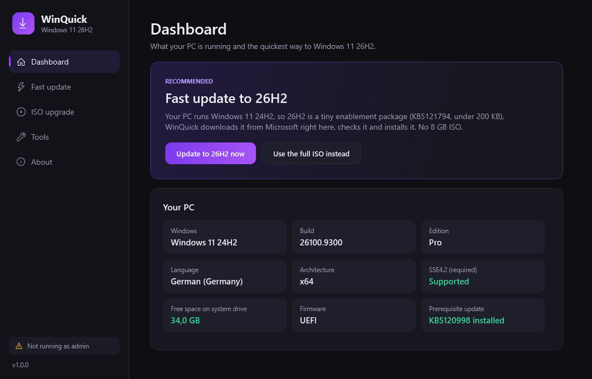
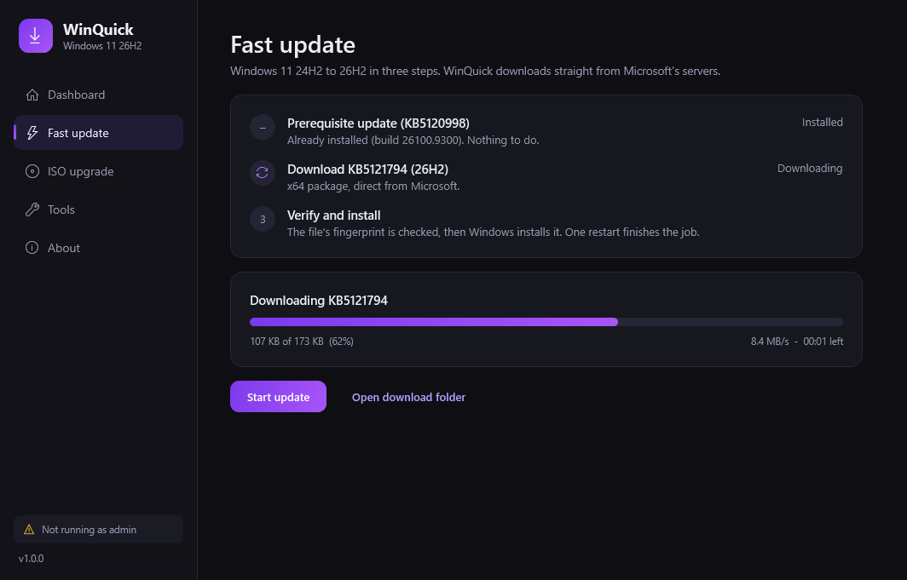

# WinQuick

**Get to Windows 11 26H2 in a few clicks.** A fast, dark-mode installer that downloads Microsoft's update files itself, checks them, and installs them. No browser detours.

Inspired by [Tips2Fix-Windows11-Installer](https://github.com/tips2fix/Tips2Fix-Windows11-Installer) (MIT). WinQuick keeps the same idea and the same registry approach, but downloads inside the app and has a new interface.

<p align="center">
  
  &nbsp;
  
</p>

## What's different

| | Original | WinQuick |
|---|---|---|
| Update packages | Opens a link in your browser | **Downloads in the app** with progress, speed and ETA |
| Interrupted download | Start over in the browser | **Resumes** where it stopped |
| File check | Separate step after you pick the file | **Automatic**: SHA-1 fingerprint is checked before install |
| 24H2/25H2 to 26H2 | Several screens and buttons | **One click** from the dashboard |
| ISO | Opens the Microsoft page | Tries a **direct download** first, falls back to the page and **picks the ISO up by itself** from Downloads |
| Look | Light WinForms | **Dark WPF, purple accents**, sidebar navigation |

## Quick start

1. Download the repo (Code, then Download ZIP) and extract it.
2. Double-click **`Run.bat`** and accept the UAC prompt.
3. Read the dashboard. Click the big button.

Requirements: Windows 10 or 11, Windows PowerShell 5.1 (built in), administrator rights, a CPU with SSE4.2.

## The two ways to 26H2

### Fast update (Windows 11 24H2 or 25H2)

26H2 is delivered to these versions as a tiny enablement package (`KB5121794`, about 174 KB). WinQuick:

1. Checks whether the prerequisite `KB5120998` is installed (by build revision). If it is missing it offers to download and install it first. That one is a full cumulative update of about 4.3 GB and needs a restart.
2. Downloads `KB5121794` straight from Microsoft's delivery servers.
3. Verifies the fingerprint Microsoft puts in the file name, installs it with DISM, and offers a restart.

### ISO upgrade (Windows 10, or Windows 11 23H2 and older)

1. **Download ISO** asks Microsoft for the ISO matching your language and saves it to `Downloads\WinQuick`.
   Microsoft protects that link behind an anti-bot check ("Sentinel") that often refuses scripted requests. WinQuick does not try to get around it. If the direct link is refused, it opens the official download page and watches your Downloads folder, then continues automatically when the ISO finishes.
2. Or pick an ISO you already have.
3. WinQuick mounts it and checks the build, language, edition and free space, so you find out *before* Setup that "Keep personal files and apps" would be lost.
4. After you confirm, it applies the registry values below and starts Setup from the mounted ISO.

## Tools

- **Skip the hardware checks** writes the `LabConfig`, `MoSetup`, `HwReqChk` and `PCHC` values that let Setup run on unsupported PCs while keeping "Keep personal files and apps". **Undo** removes exactly those.
- **Fix "We couldn't update the system reserved partition"** mounts the EFI partition, clears only `EFI\Microsoft\Boot\Fonts`, and unmounts it.

## Safety

- Asks before every change: downloads of big files, registry writes, installs, Setup, restart.
- No telemetry, no accounts, no background services, no startup entries.
- The only network traffic is to Microsoft's download servers.
- Every action is written to a log in `Logs\` (newest 20 are kept). **About** has an "Open log" button.
- `Run.bat` starts PowerShell with `-ExecutionPolicy Bypass` for that one process only.

SSE4.2 cannot be bypassed: Windows 11 24H2 and newer will not boot without it. WinQuick tells you up front.

**Disclaimer:** Installing Windows 11 on unsupported hardware is not supported by Microsoft. Use at your own risk and back up first.

## Updating for a new release

All download links, KB numbers and build numbers live in [`releases.json`](releases.json). When Microsoft ships a new version, edit that file; no code change is needed.

## Development

```powershell
# Render every page to PNGs (no admin, nothing is installed)
powershell -STA -File WinQuick.ps1 -NoElevate -Preview .\shots

# Open the ISO checker directly
powershell -STA -File WinQuick.ps1 -NoElevate -Iso C:\path\to.iso
```

Environment variables for testing: `WQ_FAKE_BUILD` / `WQ_FAKE_UBR` pretend to be another Windows build, `WQ_RELEASES` points at another releases file (for example a local test server), and `WQ_DRYRUN=1` simulates the DISM install and skips the admin check.

## Project layout

```
Run.bat              launcher (asks for administrator)
WinQuick.ps1         logic: system checks, download engine, installer, UI wiring
ui/MainWindow.xaml   the interface (dark theme, purple accents)
releases.json        links, KB numbers and build numbers
```

## License

MIT. See [LICENSE](LICENSE).
